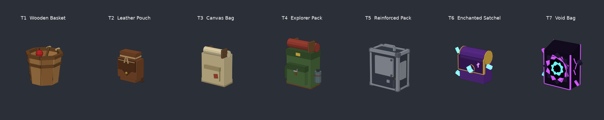
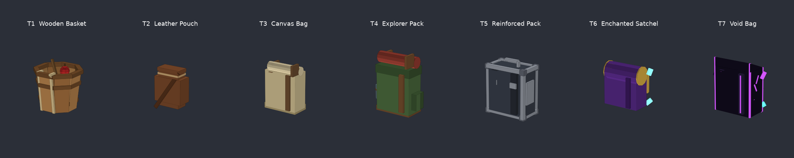
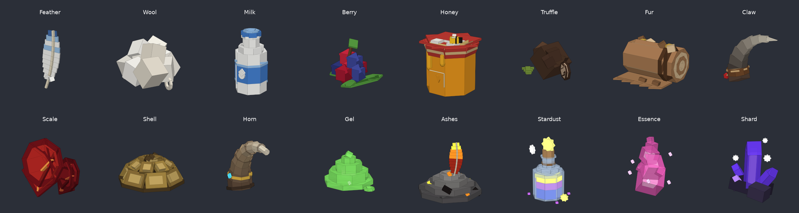

# Ghiozdane low-poly pentru Roblox

7 ghiozdane, de la cel mai slab la cel mai bun, construite din piese Roblox (Part / WedgePart / cilindri), fără mesh-uri externe:

| Tier | Nume | Rarity | Capacity* | Piese |
|---|---|---|---|---|
| 1 | Wooden Basket | Basic | 10 | 44 |
| 2 | Leather Pouch | Common | 20 | 13 |
| 3 | Canvas Bag | Uncommon | 35 | 11 |
| 4 | Explorer Pack | Rare | 60 | 18 |
| 5 | Reinforced Pack | Epic | 100 | 40 |
| 6 | Enchanted Satchel | Legendary | 175 | 20 + lumină + particule |
| 7 | Void Bag | Mythic | 300 | 34 + lumină + particule |

\* Valorile pentru Capacity sunt doar sugestii, salvate ca atribute. Le poți schimba în `BagBuilder.lua`.




*Previzualizare randată în afara Roblox din aceleași date ale pieselor. În Studio, părțile Neon strălucesc, iar Enchanted Satchel și Void Bag au și PointLight și particule.*

## Instalare

1. **Generează modelele:** deschide Studio → View → Command Bar, lipește tot conținutul din `BagBuilder.lua` și apasă Enter.
   - Apar în `ReplicatedStorage.Bags` și într-un rând de preview în `Workspace.BagShowcase`. Pe acesta din urmă îl poți șterge.
   - Dacă rulezi scriptul din nou, modelele vechi sunt înlocuite.
2. **Pune ghiozdanul pe jucător (opțional):** pune `BagEquip.server.lua` ca Script în `ServerScriptService`. Apoi, din codul tău de upgrade:
   ```lua
   player:SetAttribute("EquippedBag", "Reinforced Pack")
   ```
   Ghiozdanul se schimbă imediat și rămâne și după respawn. Funcționează cu R15 și R6.

## Structura fiecărui model

- `PrimaryPart` = `Handle`: o piesă invizibilă cât corpul ghiozdanului. Toate celelalte piese sunt sudate de ea cu `WeldConstraint`.
- Fața **-Z** stă pe spatele personajului, iar fața **+Z** (buzunarele) e spre exterior.
- Atribute: `Tier`, `Capacity`, `Rarity`, `MountHeight` (cât de sus/jos stă pe spate, în studs; ajustează dacă avatarele tale au altă scară).
- Toate piesele au `CanCollide`, `CanTouch` și `CanQuery` = false, plus `Massless` = true, ca să nu afecteze mișcarea personajului.

---

# Resurse low-poly

16 resurse generate de `ResourceBuilder.lua`, toate din piese Roblox (fără mesh-uri externe), de ~1–1.6 studs:



*Previzualizare randată în afara Roblox. În Studio, părțile Neon strălucesc, iar Gel, Ashes, Stardust, Essence și Cosmic Shard au PointLight și, unele, particule.*

## Instalare

În Studio deschizi View → Command Bar, lipești tot conținutul din `ResourceBuilder.lua` și apeși Enter. Modelele apar în `ReplicatedStorage.Resources`, cu numele = cheia din tabel. Ce apare în `Workspace.ResourceShowcase` e doar preview și îl poți șterge.

În tabelul de resurse pui numele modelului:

```lua
Feather = { DisplayName = "Feather", SellPrice = 3, Weight = 0.05, Icon = "", Model = "Feather" },
-- ... la fel pentru Wool, Milk, Berry, Honey, Truffle, Fur, Claw, Scale, Shell, Horn, Gel, Ashes, Stardust, Essence, Shard
```

și îl clonezi așa:

```lua
local model = ReplicatedStorage.Resources[def.Model]:Clone()
model:PivotTo(CFrame.new(pos + Vector3.new(0, model.PrimaryPart.Size.Y / 2, 0))) -- pus pe sol
model.Parent = workspace
```

`PrimaryPart` = `Handle` este invizibil, cât tot modelul și centrat. Toate piesele sunt sudate de el și sunt Anchored în template; pentru un drop care cade, setează `Anchored = false` pe piese. Fiecare model are atributul `ResourceId`.
